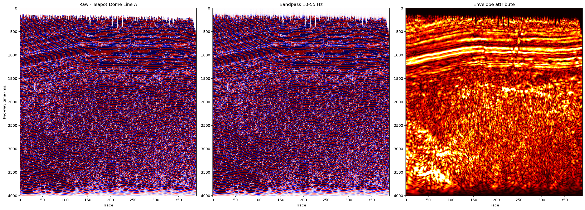

# Seismic Processing Warmup — Teapot Dome 2D Line A

A self-directed exercise in loading, filtering, and attribute computation on a real-world public SEG-Y file. No prior seismic experience when I started, so the goal was baseline literacy in the domain, such as learning the file format, the standard signal processing operations, and one commonly-used seismic attribute.

Completed over one weekend (≈5-6 hours of focused work) with no prior seismic processing experience, as domain-literacy preparation.

## Hero image



**Left:** raw 2D section from Teapot Dome Line A — each vertical column is one surface position along the line; vertical axis is two-way travel time (shallower at top, deeper at bottom). Red/blue stripes mark rock layer boundaries.

**Middle:** same section after a 10–55 Hz Butterworth bandpass filter.

**Right:** envelope attribute (Hilbert transform magnitude) — bright regions = strong reflection energy regardless of polarity.

**What's visible:**

- Clean horizontal bands from 500–1250 ms — stacked rock layers, each band where one rock type meets another.
- Those bands bulge upward around traces 100–180 — a shallow dome in the top section.
- Below 1500 ms the picture gets fuzzier — normal; deeper signal is weaker.
- The bottom-left (traces 0–100, 2500–3800 ms) is noticeably brighter than the matching depths on the right side — something structural changes across the line at that depth.
- The dark band at the very top (0–150 ms) is a standard processing step that removes surface noise.

Naming the specific rock formations would need well-log data, which isn't in scope here.

## What this notebook does

1. Load a 2D post-stack SEG-Y line using `segyio`; inspect trace count, sample rate, record length.
2. Visualise the 2D section with appropriate colour clipping.
3. Extract one trace, FFT it, identify the frequency band of the signal (~10–55 Hz, dominant ~32 Hz).
4. Apply a 4th-order Butterworth bandpass filter, zero-phase via `filtfilt`.
5. Inject synthetic noise (2 Hz drift + 90 Hz tone + white noise) into one trace, re-apply the filter, verify clean removal.
6. Compute the envelope attribute via Hilbert transform.
7. Side-by-side comparison: raw / filtered / envelope.

## Key finding

The 10–55 Hz bandpass filter produced no visible change to the raw data. Spectral inspection of individual traces explained why — signal is natively bounded between ~12 Hz and ~55 Hz with a dominant frequency around 32 Hz, indicating the Teapot Dome volume was already spectrally shaped during prior processing.

Rather than accept the null result, I verified filter correctness by injecting synthetic out-of-band noise into one trace: 2 Hz low-frequency drift, a 90 Hz high-frequency tone, and broadband white noise. Spectrum comparison showed clean removal of both out-of-band components with in-band signal fully preserved. The in-band portion of the random white noise survived, as expected — bandpass filtering cannot distinguish in-band signal from in-band noise.

Conclusion: the filter is correct; the native data on this volume doesn't need it.

## How to run

```bash
python -m venv .venv
source .venv/bin/activate   # macOS/Linux
# Windows: .\.venv\Scripts\activate

pip install -r requirements.txt

# Download Teapot Dome Line A (SEG-Y, Git LFS):
# https://github.com/softwareunderground/TeapotDome/tree/main/source/2D_Seismic
# Place at: ./teapot.sgy/lineA.sgy

jupyter lab seismic_warmup.ipynb
```

## Dataset

Teapot Dome 3D Survey — public-domain seismic from Wyoming, released by the Rocky Mountain Oilfield Testing Center (RMOTC) / US Department of Energy. 2D Line A was obtained from the [softwareunderground/TeapotDome](https://github.com/softwareunderground/TeapotDome) mirror.

## Toolkit

- `segyio` — SEG-Y I/O (Equinor)
- `numpy`, `scipy.signal` — FFT, Butterworth filter, Hilbert transform
- `matplotlib` — plotting

## What I'd do next with more time

- Instantaneous frequency (second Hilbert attribute) — can flag gas-bearing zones
- Horizon picking across the 2D line
- Load a full 3D volume (inline / crossline / time-slice views)
- Multi-attribute analysis for seismic facies classification

Completed over one weekend (≈5-6 hours of focused work) with no prior seismic processing experience, as domain-literacy preparation.